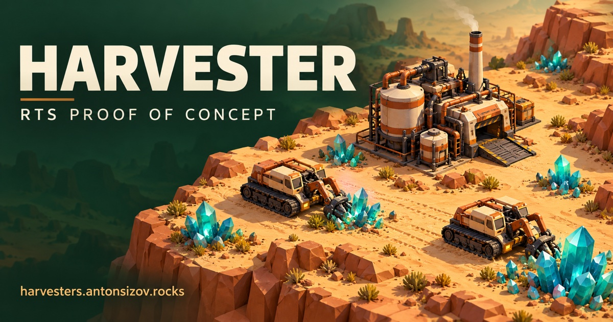

# HARVESTER



A small crew. A vast desert.

An RTS proof of concept for the browser, hosted at <https://harvesters.antonsizov.rocks/>. Search and social metadata are in `index.html`; the sharing cover is `public/og/harvester.jpg`. Crawler discovery files live in `public/robots.txt` and `public/sitemap.xml`.

A playable desert RTS vertical slice: two autonomous tracked harvesters, one shared refinery, a construction yard, five slowly regenerating cyan mineral deposits, three controllable tanks, and an editable Blender-authored world. Each harvester finds resources, follows A* routes, mines, waits its turn, aligns nose first at one unloading point, unloads, and drives clear before the next unit enters. Deposits lose individual Blender-authored crystals as they are depleted and grow them back as they recover, with percentage, grade, and regrowth indicators. Their turquoise facets slowly shimmer with a subtle glow; the animation follows simulation pause and speed. Outside the playable heightfield, a black backdrop makes the map boundary visible when zooming out or panning.

The **Courtyard / CY-01** has a workshop, overhead gantry crane, command block, antenna, and supply stacks. Its reserved 16 × 14 m footprint sits west of the refinery, leaving an 8 m passage for units. The refinery emits a light, drifting smoke plume from its taller chimney while accepting cargo; remaining smoke gently dissipates after unloading.

## Run

Use Node.js 22.12+ (Node 24 LTS recommended), npm, and a modern browser with WebGL 2.

```sh
npm install
npm run dev
```

Open <http://127.0.0.1:5173>. Ready-to-use GLBs are included; Blender is only needed to regenerate or edit assets. Fonts are bundled locally. No accounts, keys, or external services are required.

## Controls

| Input                           | Action                                         |
| ------------------------------- | ---------------------------------------------- |
| WASD / arrow keys               | Pan camera                                     |
| Mouse wheel                     | Smooth zoom                                    |
| Middle-button drag / touch drag | Pan camera                                     |
| Click vehicle / fleet button    | Select                                         |
| Left-click reachable ground     | Move selected vehicle                          |
| Left-click crystals (harvester) | Harvest that mineral field                     |
| Left-click Refinery (harvester) | Deliver current cargo through the dock queue   |
| Esc / deselect button           | Deselect                                       |
| F / Locate / minimap            | Select and center vehicle                      |
| Space / pause button            | Pause or resume simulation                     |
| 1× button                       | Cycle 1×, 2×, 4× simulation speed              |
| Hold / Autopilot                | Stop unit, or resume autonomous work           |
| Return arrow                    | Deliver current cargo                          |
| G                               | Toggle logical grid; blocked cells appear red  |
| P                               | Toggle remaining navigation path               |
| Sliders button                  | Developer controls and postprocessing settings |

The simulation starts when assets are ready and pauses in hidden tabs. The camera stays usable while the simulation is paused. Select any vehicle, then left-click the ground to move it: a green cursor marks reachable ground and a red cursor marks blocked or unreachable destinations. Accepted orders flash a target reticle and play a random voice confirmation. Invalid clicks retain the current order and selection. Camera drags do not issue orders. On touch screens, tap to move and drag to pan.

A manual MOVE retains cargo and leaves the harvester waiting at its destination. Choose **Autopilot** to resume autonomous harvesting. Orders issued while paused execute after resuming. For a harvester, left-click crystals to start mining that field, or the Refinery to unload a partial or full load. Dedicated crystal and unload cursors show the contextual action. An empty cargo bay or unreachable/depleted field shows a rejection without replacing the current order. A harvest order received in port is remembered until unloading and departure are safely complete. After delivery, autonomous extraction resumes. Tanks only accept MOVE and Hold; buildings and mineral fields remain blocked destinations.

Selecting any vehicle plays one of four random **“Yes sir!”** acknowledgements, without consecutive repeats or overlapping voices. The initial selection stays silent. The supplied ElevenLabs MP3s are grouped under `public/audio/voices/harvester/selection/`.

Accepted movement, harvesting and unloading orders use all six existing takes from `public/audio/voices/harvester/orders/move-order-01.mp3` through `move-order-06.mp3`. Each group avoids immediate repeats; selection and movement share one speech channel.

Seven background tracks play in order and repeat the playlist, starting with your first action. The **FIELD RADIO** panel offers Play/Pause, Next, volume, and song selection. Music defaults to 25% volume and pauses in hidden tabs. Named assets live in `public/audio/music/`; see [game audio](docs/audio.md) for titles, source mappings, and playback behavior.

Resting mineral fields regenerate **12 M per simulation minute**, up to their original capacity. Autonomous harvesters wait for **24 M** before setting out again, then resume without player input. Regeneration freezes with the simulation and follows its speed setting. Rates and dispatch reserve are configurable in `src/game/config.ts`.

Harvester bodies gently pitch on acceleration and braking, then settle through a damped suspension animation while the tracks stay grounded. Reverse travel mirrors the response and sends dust from the front ends of the tracks. Presentation tuning lives in `src/rendering/entities/harvesterMotion.ts`.

The light **Sand scout**, medium **Dune ranger**, and heavy **Basin sentinel** start on the northern perimeter, clear of mining and docking routes. They have distinct Blender-authored silhouettes and top speeds of 7.2 / 5.6 / 4 m/s. Idle turrets occasionally scan the perimeter; moving turrets return forward. Scans follow simulation pause and speed. There is no firing yet; each GLB has separate `TurretYaw`, `GunPitch`, and `Muzzle` nodes for future aiming and projectile spawning.

## Development

```sh
npm run test                # Node-only deterministic tests
npm run test:watch
npm run typecheck
npm run lint
npm run format
npm run format:check
npm run architecture:check  # Simulation/rendering and Blender boundaries
npm run assets:check        # GLB structure, pivots, and exact terrain-height checks
npm run build
npm run preview
npm run validate            # All static, simulation, asset, and production checks
```

## Assets

All visible game-world meshes, including particle shapes and the selection ring, originate in Blender. No runtime world models are assembled from Three.js primitives. Debug lines are the only code-generated geometry.

```sh
npm run assets:generate             # Recreate all .blend, GLB, terrain metadata; optimize
npm run assets:export -- harvester  # Export an edited .blend without regenerating it
npm run assets:export -- terrain    # Also update navigation heights from the edited grid
npm run assets:optimize             # Lossless deduplication/welding/pruning
npm run assets:check
```

Blender is detected from PATH, the standard macOS application, or `BLENDER_BIN`. Authoring was verified with Blender 5.2.3 LTS. **Generation replaces the generated .blend sources; use `assets:export` to preserve manual edits.** See [the asset workflow](docs/assets.md).

## Structure

```text
assets/world.json       Shared map layout and generation seed
assets/blender/         Editable .blend sources
public/models/          Optimized runtime GLBs
public/audio/           Local music playlist and unit voice takes
scripts/blender/        Reproducible Blender authoring/export scripts
src/game/               Pure TypeScript gameplay; no React, Three.js, or Zustand
  navigation/           Logical grid, occupancy, exact height sampling, deterministic A*
  simulation/           World ownership, harvesting and tank behaviors
  commands/             Validated command queue, executed at tick boundaries
  economy/              Resource balances and reservable refinery receiver
  core/                 Bounded 20 Hz fixed-step clock
src/app/                Browser scheduling, runtime ownership, low-frequency Zustand bridge
src/audio/              Independent music and grouped harvester speech
src/rendering/          R3F scene, GLB instances, interpolation, camera, visual effects
src/ui/                 DOM HUD, selection information, minimap, developer controls
docs/                   Specification, architecture, asset workflow, validation evidence
```

Gameplay tuning lives in `src/game/config.ts`. Grid dimensions and scene layout live in `assets/world.json`; regenerate assets after changing map dimensions. The default navigation grid is 64 × 64 at 2 m per cell. Terrain triangles and navigation share one exported heightfield.

See [fleet, docking, and mineral regrowth](docs/fleet-and-docking.md), [architecture and extension points](docs/architecture.md), [validation](docs/validation.md), and the [original specification](docs/specification.md).

## Scope and limits

This is a five-unit, two-building desktop browser prototype. Courtyard is the placed construction-yard building; building placement and production controls are future work. The map starts with 3,660 minerals; slow regrowth provides continued income after the initial reserves run down. Reload to start a new shift. There is no combat, save/load, or physics. The refinery uses a FIFO queue with distinct waiting bays, a reserved approach, fixed unloading pose, and reverse departure. Nearby units yield and replan with clearance; this is not a general crowd-navigation system. Holding a unit inside the port intentionally keeps the dock occupied until that unit resumes or drives clear.

Portrait layouts and touch panning are supported, but multi-touch pinch zoom and full mobile controls are not implemented. Performance has been smoke-tested in Chromium; cross-browser and large-fleet performance are not yet benchmarked. The Three.js production chunk exceeds Vite's default 500 KB warning threshold; the canvas code is lazy-loaded separately from the HUD.
